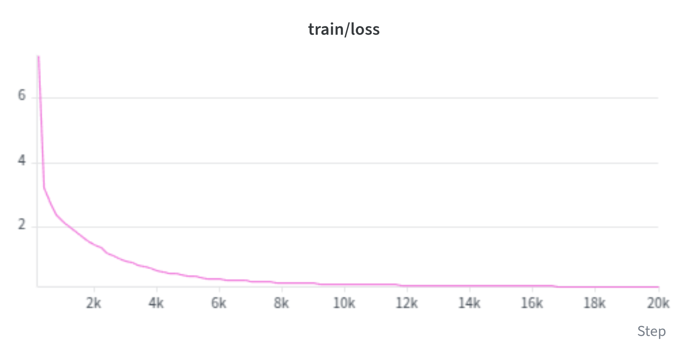
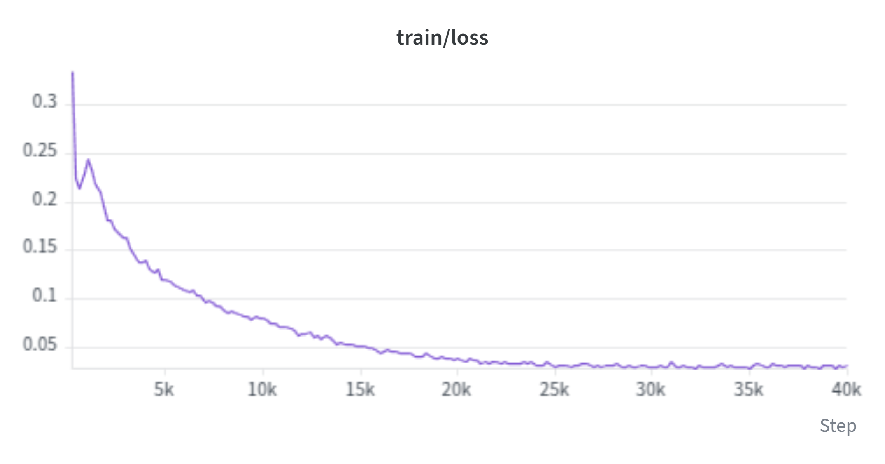

# SO-101 VLA 开发记录

> 用 LeRobot 在自攒 SO-101 机械臂上完成 VLA 全链路开发的展示记录：
> 硬件搭建 → 标定 → 遥操作 → 数据采集 → 训练（ACT / SmolVLA / pi0）→ 真机推理。
> 训练任务：**"Put the toy on the plate"**（把玩具放到盘子上）。

| 项目 | 内容 |
|---|---|
| 机械臂 | SO-101 leader + follower（自攒，Feetech STS3215 舵机） |
| 相机 | 腕部 + 顶部双路 USB 相机，640×480 @ 30fps |
| 数据 | `niuwengang123/lerobot_dataset_put_toy`，40 条遥操作 episode，LeRobotDataset v3.0 |
| 算法 | ACT（训练+真机）、SmolVLA（从零+微调+真机）、pi0（全量+LoRA） |
| 框架 | LeRobot（源码安装）+ wandb / nvitop 监控 |

---

## 1. 软件环境

```bash
conda create -y -n lerobot python=3.12
conda activate lerobot
git clone https://github.com/huggingface/lerobot.git
cd lerobot
pip install -e ".[feetech]"
```

环境自检：

```bash
python -c "
import torch, lerobot
print('CUDA available:', torch.cuda.is_available())
print('CUDA version:', torch.version.cuda)
print('Lerobot version:', lerobot.__version__)
"
```

## 2. 舵机标定

```bash
ls /dev/ttyACM*

lerobot-calibrate \
    --teleop.type=so101_leader \
    --teleop.port=/dev/ttyACM0 \
    --teleop.id=g_leader_arm

lerobot-calibrate \
    --robot.type=so101_follower \
    --robot.port=/dev/ttyACM1 \
    --robot.id=g_follower_arm
```

## 3. 遥操作

```bash
lerobot-teleoperate \
  --robot.type=so101_follower \
  --robot.port=/dev/ttyACM1 \
  --robot.id=g_follower_arm \
  --teleop.type=so101_leader \
  --teleop.port=/dev/ttyACM0 \
  --teleop.id=g_leader_arm
```

## 4. 数据采集

采集质量参考：[what makes a good dataset](https://huggingface.co/blog/lerobot-datasets#what-makes-a-good-dataset)（复位位姿一致、背景干净、成功轨迹覆盖完整）。

```bash
lerobot-record \
  --robot.type=so101_follower \
  --robot.port=/dev/ttyACM1 \
  --robot.id=g_follower_arm \
  --robot.cameras='{"wrist":{"type":"opencv","index_or_path":"/dev/video4","width":640,"height":480,"fps":30,"fourcc":"MJPG"},"top":{"type":"opencv","index_or_path":"/dev/video0","width":640,"height":480,"fps":30,"fourcc":"MJPG"}}' \
  --teleop.type=so101_leader \
  --teleop.port=/dev/ttyACM0 \
  --teleop.id=g_leader_arm \
  --dataset.repo_id=niuwengang123/lerobot_dataset_put_toy \
  --dataset.root=$DATA_ROOT/lerobot_dataset_put_toy \
  --dataset.num_episodes=40 \
  --dataset.single_task="Put the toy on the plate" \
  --dataset.push_to_hub=false \
  --dataset.episode_time_s=60 \
  --dataset.reset_time_s=10 \
  --display_data=true
```


采集演示：

<video src="https://raw.githubusercontent.com/wengang-niu/so101_vla/main/media/data_collection.mp4" controls width="720"></video>
（[视频文件](media/data_collection.mp4)）

## 5. 数据格式（LeRobotDataset v3.0）

- **`data/`** — 数值：每帧一行 parquet（action、observation.state、时间戳、各种 index）
- **`videos/`** — 图像：每个相机一个子目录，帧编进 mp4（av1/yuv420p/30fps）
- **`meta/`** — 描述：`info.json`（身份信息）、`stats.json`（统计）、`tasks.parquet`（任务）、`episodes/`（每集元数据）

## 6. 数据可视化

- https://huggingface.co/spaces/lerobot/visualize_dataset
- http://io-ai.tech/lerobot

## 7. Hugging Face 上传 / 下载

```bash
pip install huggingface_hub
hf auth login        # 交互式登录，勿硬编码 token
hf upload niuwengang123/lerobot_dataset_put_toy ./data/ --repo-type=dataset
hf download --repo-type dataset niuwengang123/lerobot_dataset_put_toy --local-dir ./data
```

## 8. 训练监控

```bash
pip install wandb && wandb login   # 交互式登录，勿硬编码 API key
pip install nvitop                 # 盯显存 / 利用率
```

---

## 9. 训练与推理

### 9.1 ACT

**训练：**

```bash
lerobot-train \
  --dataset.repo_id=niuwengang123/lerobot_dataset_put_toy \
  --dataset.root=$DATA_ROOT/lerobot_dataset_put_toy \
  --dataset.revision=main \
  --dataset.streaming=false \
  --policy.type=act \
  --output_dir=$OUTPUT_DIR/toy/act/ \
  --job_name=toy \
  --policy.device=cuda \
  --wandb.enable=true \
  --wandb.project=toy_project_act \
  --policy.push_to_hub=false \
  --steps=20000 \
  --batch_size=6
```



**真机推理：**

```bash
lerobot-rollout \
  --strategy.type=base \
  --robot.type=so101_follower \
  --robot.port=/dev/ttyACM1 \
  --robot.cameras='{"wrist":{"type":"opencv","index_or_path":"/dev/video0","width":640,"height":480,"fps":30,"fourcc":"MJPG"},"top":{"type":"opencv","index_or_path":"/dev/video4","width":640,"height":480,"fps":30,"fourcc":"MJPG"}}' \
  --robot.id=g_follower_arm \
  --display_data=true \
  --task="Put the toy on the plate" \
  --duration=10000 \
  --policy.path=$OUTPUT_DIR/toy/act/checkpoints/020000/pretrained_model
```

真机演示（ACT）：

<video src="https://raw.githubusercontent.com/wengang-niu/so101_vla/main/media/act_infer.mp4" controls width="720"></video>
（[视频文件](media/act_infer.mp4)）

### 9.2 SmolVLA

**训练（全量）：**

```bash
lerobot-train \
  --dataset.repo_id=niuwengang123/lerobot_dataset_put_toy \
  --dataset.root=$DATA_ROOT/lerobot_dataset_put_toy \
  --dataset.revision=main \
  --dataset.streaming=false \
  --policy.type=smolvla \
  --output_dir=$OUTPUT_DIR/lerobot/output \
  --job_name=toy_smolvla \
  --policy.device=cuda \
  --wandb.enable=true \
  --wandb.project=toy_project_smolvla \
  --policy.push_to_hub=false \
  --steps=40000 \
  --batch_size=8
```

**训练（从 `lerobot/smolvla_base` 微调）：**

```bash
lerobot-train \
  --policy.path=lerobot/smolvla_base \
  --dataset.repo_id=niuwengang123/lerobot_dataset_put_toy \
  --dataset.root=$DATA_ROOT/lerobot_dataset_put_toy \
  --dataset.revision=main \
  --dataset.streaming=false \
  --output_dir=$OUTPUT_DIR/lerobot/output \
  --job_name=toy_smolvla \
  --policy.device=cuda \
  --policy.empty_cameras=1 \
  --rename_map='{"observation.images.top": "observation.images.camera1", "observation.images.wrist": "observation.images.camera2"}' \
  --wandb.enable=true \
  --wandb.project=toy_project_smolvla \
  --policy.push_to_hub=false \
  --steps=40000 \
  --batch_size=8
```

> `--rename_map` 把数据集的相机键名映射到 checkpoint 期望的 `camera1/camera2`；
> `--policy.empty_cameras=1` 补齐相机槽位。微调和推理时都要带上。



**真机推理：**

```bash
lerobot-rollout \
  --strategy.type=base \
  --robot.type=so101_follower \
  --robot.port=/dev/ttyACM1 \
  --robot.cameras='{"wrist":{"type":"opencv","index_or_path":"/dev/video4","width":640,"height":480,"fps":30,"fourcc":"MJPG"},"top":{"type":"opencv","index_or_path":"/dev/video0","width":640,"height":480,"fps":30,"fourcc":"MJPG"}}' \
  --robot.id=g_follower_arm \
  --rename_map='{"observation.images.top":"observation.images.camera1","observation.images.wrist":"observation.images.camera2"}' \
  --display_data=false \
  --task="Put the toy on the plate" \
  --duration=10000 \
  --policy.path=$OUTPUT_DIR/model/smolvla_040000/040000/pretrained_model
```

真机演示（SmolVLA）：

<video src="https://raw.githubusercontent.com/wengang-niu/so101_vla/main/media/smolvla_infer.mp4" controls width="720"></video>
（[视频文件](media/smolvla_infer.mp4)）

### 9.3 pi0

**训练（全量）：**

```bash
# 依赖
pip install -e ".[pi]"
pip install 'lerobot[dataset]'
pip install 'lerobot[training]'
```

```bash
lerobot-train \
  --dataset.repo_id=niuwengang123/lerobot_dataset_put_toy \
  --dataset.revision=main \
  --dataset.root=$DATA_ROOT/lerobot_dataset_put_toy \
  --dataset.streaming=false \
  --policy.type=pi0 \
  --output_dir=$OUTPUT_DIR/toy_pi0 \
  --job_name=toy_pi0 \
  --policy.pretrained_path=lerobot/pi0_base \
  --policy.compile_model=true \
  --policy.gradient_checkpointing=true \
  --policy.dtype=bfloat16 \
  --policy.freeze_vision_encoder=false \
  --policy.train_expert_only=false \
  --steps=50000 \
  --policy.device=cuda \
  --policy.push_to_hub=false \
  --wandb.enable=true \
  --wandb.project=toy_project_pi_0 \
  --batch_size=8
```

**训练（LoRA 微调）：**

```bash
pip install 'lerobot[peft]'
```

```bash
lerobot-train \
  --dataset.repo_id=niuwengang123/lerobot_dataset_put_toy \
  --dataset.revision=main \
  --dataset.root=$DATA_ROOT/lerobot_dataset_put_toy \
  --dataset.streaming=false \
  --policy.type=pi0 \
  --output_dir=$OUTPUT_DIR/toy_pi0_lora \
  --job_name=toy_pi0_lora \
  --policy.pretrained_path=lerobot/pi0_base \
  --policy.compile_model=false \
  --policy.gradient_checkpointing=true \
  --policy.dtype=bfloat16 \
  --steps=3000 \
  --policy.device=cuda \
  --policy.push_to_hub=false \
  --wandb.enable=true \
  --wandb.project=toy_project_pi_0 \
  --batch_size=8 \
  --peft.method_type=LORA \
  --peft.r=16 \
  --peft.lora_alpha=16
```

> 显存技巧：`gradient_checkpointing` + `bfloat16` +（可选）`train_expert_only` 是
> 3B 级 pi0 塞进 48GB 单机的关键；LoRA（r=16）进一步把可训练参数压到 ~1%。
> **真机推理暂略**（待补：pi0 bf16 推理 >8GB，需 int8 / ONNX / 远程推理）。

---

## 下一步

- 补齐 pi0 真机推理记录与三个算法的正式成功率表
- 自研方向：VLA 持续学习（任务级 LoRA 专家累积 + 新颖度门控回放 + 真机持续学习 benchmark）
- 部署侧：ONNX fp16/int8 导出，8GB 显卡实时推理

## License

Apache-2.0（代码与文档）。pi0 等第三方权重受其自身许可约束（Gemma ToU），不随仓库分发。
