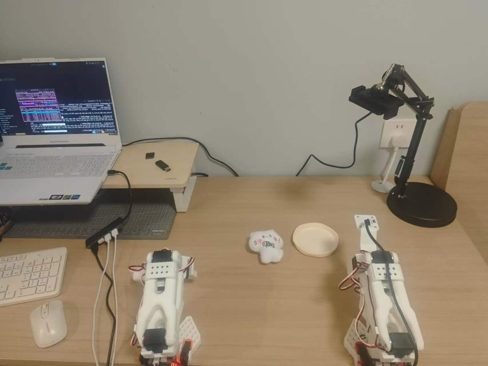
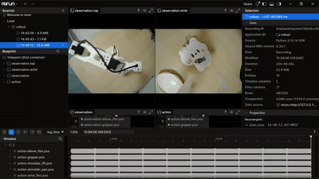
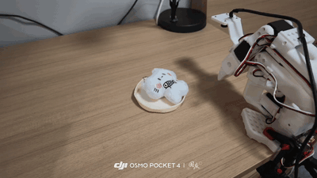
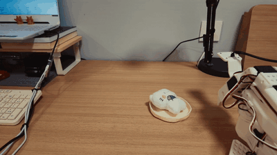

# SO-101 VLA

> 两个章节：**经典方案复现**——用 LeRobot 在自攒 SO-101 机械臂上跑通 ACT / SmolVLA / pi0
> 的全链路记录（标定 → 遥操作 → 数据采集 → 训练 → 真机推理）；**我的 miniVLA**——从零实现
> 一个小 VLA 吃透每个组件，并在它上面做持续学习创新。
> 训练任务：**"Put the toy on the plate"**（把玩具放到盘子上）。

| 项目 | 内容 |
|---|---|
| 机械臂 | SO-101 leader + follower（自攒，Feetech STS3215 舵机） |
| 相机 | 腕部 + 顶部双路 USB 相机，640×480 @ 30fps |
| 数据 | `niuwengang123/lerobot_dataset_put_toy`，40 条遥操作 episode，LeRobotDataset v3.0 |
| 算法 | ACT（训练+真机）、SmolVLA（从零+微调+真机）、pi0（全量+LoRA） |
| 框架 | LeRobot（源码安装）+ wandb / nvitop 监控 |

---

# 经典方案复现

## 1. 软件环境

```bash
conda create -y -n lerobot python=3.12
conda activate lerobot
git clone https://github.com/huggingface/lerobot.git
cd lerobot
pip install -e ".[feetech]"
```

环境自检：

```bash
python -c "
import torch, lerobot
print('CUDA available:', torch.cuda.is_available())
print('CUDA version:', torch.version.cuda)
print('Lerobot version:', lerobot.__version__)
"
```

## 2. 舵机标定

```bash
ls /dev/ttyACM*

lerobot-calibrate \
    --teleop.type=so101_leader \
    --teleop.port=/dev/ttyACM0 \
    --teleop.id=g_leader_arm

lerobot-calibrate \
    --robot.type=so101_follower \
    --robot.port=/dev/ttyACM1 \
    --robot.id=g_follower_arm
```

## 3. 遥操作

```bash
lerobot-teleoperate \
  --robot.type=so101_follower \
  --robot.port=/dev/ttyACM1 \
  --robot.id=g_follower_arm \
  --teleop.type=so101_leader \
  --teleop.port=/dev/ttyACM0 \
  --teleop.id=g_leader_arm
```

## 4. 数据采集

采集质量参考：[what makes a good dataset](https://huggingface.co/blog/lerobot-datasets#what-makes-a-good-dataset)（复位位姿一致、背景干净、成功轨迹覆盖完整）。

```bash
lerobot-record \
  --robot.type=so101_follower \
  --robot.port=/dev/ttyACM1 \
  --robot.id=g_follower_arm \
  --robot.cameras='{"wrist":{"type":"opencv","index_or_path":"/dev/video4","width":640,"height":480,"fps":30,"fourcc":"MJPG"},"top":{"type":"opencv","index_or_path":"/dev/video0","width":640,"height":480,"fps":30,"fourcc":"MJPG"}}' \
  --teleop.type=so101_leader \
  --teleop.port=/dev/ttyACM0 \
  --teleop.id=g_leader_arm \
  --dataset.repo_id=niuwengang123/lerobot_dataset_put_toy \
  --dataset.root=$DATA_ROOT/lerobot_dataset_put_toy \
  --dataset.num_episodes=40 \
  --dataset.single_task="Put the toy on the plate" \
  --dataset.push_to_hub=false \
  --dataset.episode_time_s=60 \
  --dataset.reset_time_s=10 \
  --display_data=true
```



采集演示：



（动图；完整视频：[data_collection.mp4](media/data_collection.mp4)）

## 5. 数据格式（LeRobotDataset v3.0）

- **`data/`** — 数值：每帧一行 parquet（action、observation.state、时间戳、各种 index）
- **`videos/`** — 图像：每个相机一个子目录，帧编进 mp4（av1/yuv420p/30fps）
- **`meta/`** — 描述：`info.json`（身份信息）、`stats.json`（统计）、`tasks.parquet`（任务）、`episodes/`（每集元数据）

## 6. 数据可视化

- https://huggingface.co/spaces/lerobot/visualize_dataset
- http://io-ai.tech/lerobot

## 7. Hugging Face 上传 / 下载

```bash
pip install huggingface_hub
hf auth login        # 交互式登录，勿硬编码 token
hf upload niuwengang123/lerobot_dataset_put_toy ./data/ --repo-type=dataset
hf download --repo-type dataset niuwengang123/lerobot_dataset_put_toy --local-dir ./data
```

## 8. 训练监控

```bash
pip install wandb && wandb login   # 交互式登录，勿硬编码 API key
pip install nvitop                 # 盯显存 / 利用率
```

---

## 9. 训练与推理

### 9.1 ACT

**训练：**

```bash
lerobot-train \
  --dataset.repo_id=niuwengang123/lerobot_dataset_put_toy \
  --dataset.root=$DATA_ROOT/lerobot_dataset_put_toy \
  --dataset.revision=main \
  --dataset.streaming=false \
  --policy.type=act \
  --output_dir=$OUTPUT_DIR/toy/act/ \
  --job_name=toy \
  --policy.device=cuda \
  --wandb.enable=true \
  --wandb.project=toy_project_act \
  --policy.push_to_hub=false \
  --steps=20000 \
  --batch_size=6
```


**真机推理：**

```bash
lerobot-rollout \
  --strategy.type=base \
  --robot.type=so101_follower \
  --robot.port=/dev/ttyACM1 \
  --robot.cameras='{"wrist":{"type":"opencv","index_or_path":"/dev/video0","width":640,"height":480,"fps":30,"fourcc":"MJPG"},"top":{"type":"opencv","index_or_path":"/dev/video4","width":640,"height":480,"fps":30,"fourcc":"MJPG"}}' \
  --robot.id=g_follower_arm \
  --display_data=true \
  --task="Put the toy on the plate" \
  --duration=10000 \
  --policy.path=$OUTPUT_DIR/toy/act/checkpoints/020000/pretrained_model
```

真机演示（ACT）：



（动图；完整视频：[act_infer.mp4](media/act_infer.mp4)）

### 9.2 SmolVLA

**训练（全量）：**

```bash
lerobot-train \
  --dataset.repo_id=niuwengang123/lerobot_dataset_put_toy \
  --dataset.root=$DATA_ROOT/lerobot_dataset_put_toy \
  --dataset.revision=main \
  --dataset.streaming=false \
  --policy.type=smolvla \
  --output_dir=$OUTPUT_DIR/lerobot/output \
  --job_name=toy_smolvla \
  --policy.device=cuda \
  --wandb.enable=true \
  --wandb.project=toy_project_smolvla \
  --policy.push_to_hub=false \
  --steps=40000 \
  --batch_size=8
```

**训练（从 `lerobot/smolvla_base` 微调）：**

```bash
lerobot-train \
  --policy.path=lerobot/smolvla_base \
  --dataset.repo_id=niuwengang123/lerobot_dataset_put_toy \
  --dataset.root=$DATA_ROOT/lerobot_dataset_put_toy \
  --dataset.revision=main \
  --dataset.streaming=false \
  --output_dir=$OUTPUT_DIR/lerobot/output \
  --job_name=toy_smolvla \
  --policy.device=cuda \
  --policy.empty_cameras=1 \
  --rename_map='{"observation.images.top": "observation.images.camera1", "observation.images.wrist": "observation.images.camera2"}' \
  --wandb.enable=true \
  --wandb.project=toy_project_smolvla \
  --policy.push_to_hub=false \
  --steps=40000 \
  --batch_size=8
```

> `--rename_map` 把数据集的相机键名映射到 checkpoint 期望的 `camera1/camera2`；
> `--policy.empty_cameras=1` 补齐相机槽位。微调和推理时都要带上。


**真机推理：**

```bash
lerobot-rollout \
  --strategy.type=base \
  --robot.type=so101_follower \
  --robot.port=/dev/ttyACM1 \
  --robot.cameras='{"wrist":{"type":"opencv","index_or_path":"/dev/video4","width":640,"height":480,"fps":30,"fourcc":"MJPG"},"top":{"type":"opencv","index_or_path":"/dev/video0","width":640,"height":480,"fps":30,"fourcc":"MJPG"}}' \
  --robot.id=g_follower_arm \
  --rename_map='{"observation.images.top":"observation.images.camera1","observation.images.wrist":"observation.images.camera2"}' \
  --display_data=false \
  --task="Put the toy on the plate" \
  --duration=10000 \
  --policy.path=$OUTPUT_DIR/model/smolvla_040000/040000/pretrained_model
```

真机演示（SmolVLA）：



（动图；完整视频：[smolvla_infer.mp4](media/smolvla_infer.mp4)）

### 9.3 pi0

**训练（全量）：**

```bash
# 依赖
pip install -e ".[pi]"
pip install 'lerobot[dataset]'
pip install 'lerobot[training]'
```

```bash
lerobot-train \
  --dataset.repo_id=niuwengang123/lerobot_dataset_put_toy \
  --dataset.revision=main \
  --dataset.root=$DATA_ROOT/lerobot_dataset_put_toy \
  --dataset.streaming=false \
  --policy.type=pi0 \
  --output_dir=$OUTPUT_DIR/toy_pi0 \
  --job_name=toy_pi0 \
  --policy.pretrained_path=lerobot/pi0_base \
  --policy.compile_model=true \
  --policy.gradient_checkpointing=true \
  --policy.dtype=bfloat16 \
  --policy.freeze_vision_encoder=false \
  --policy.train_expert_only=false \
  --steps=50000 \
  --policy.device=cuda \
  --policy.push_to_hub=false \
  --wandb.enable=true \
  --wandb.project=toy_project_pi_0 \
  --batch_size=8
```

**训练（LoRA 微调）：**

```bash
pip install 'lerobot[peft]'
```

```bash
lerobot-train \
  --dataset.repo_id=niuwengang123/lerobot_dataset_put_toy \
  --dataset.revision=main \
  --dataset.root=$DATA_ROOT/lerobot_dataset_put_toy \
  --dataset.streaming=false \
  --policy.type=pi0 \
  --output_dir=$OUTPUT_DIR/toy_pi0_lora \
  --job_name=toy_pi0_lora \
  --policy.pretrained_path=lerobot/pi0_base \
  --policy.compile_model=false \
  --policy.gradient_checkpointing=true \
  --policy.dtype=bfloat16 \
  --steps=3000 \
  --policy.device=cuda \
  --policy.push_to_hub=false \
  --wandb.enable=true \
  --wandb.project=toy_project_pi_0 \
  --batch_size=8 \
  --peft.method_type=LORA \
  --peft.r=16 \
  --peft.lora_alpha=16
```

> 显存技巧：`gradient_checkpointing` + `bfloat16` +（可选）`train_expert_only` 是
> 3B 级 pi0 塞进 48GB 单机的关键；LoRA（r=16）进一步把可训练参数压到 ~1%。
> **真机推理暂略**（待补：pi0 bf16 推理 >8GB，需 int8 / ONNX / 远程推理）。

---

# 我的 miniVLA

> 从零实现一个小型 VLA（<25M 参数），把论文里的每个模块变成自己写过的代码；
> 并在它上面做持续学习方向的探索。当前状态：方案思路先行，代码随后开工。

## 思路

- **为什么从零攒**：SmolVLA / pi0.5 的论文结构已经清楚，缺的是把视觉编码、语言条件化、多模态融合、动作生成、推理循环逐个亲手实现一遍——mini-VLA 是论文到代码的最短路径。
- **为什么做小**：<25M 参数（ViT-tiny + 小型融合 transformer），单卡轻松训练、8GB 内从容部署；也是持续学习消融的廉价试验床。
- **一条代码路径**：实现为 LeRobot `PreTrainedPolicy` 子类，`lerobot-train` → `lerobot-eval`（PushT / Meta-World）→ `lerobot-rollout` 真机部署，同一套代码。

## 设计

| 组件 | 方案 |
|---|---|
| 视觉编码 | ViT-tiny，多相机 token（含相机 ID 嵌入） |
| 语言编码 | 小型 transformer，定长 prefix token |
| 融合 | action-query token 对视觉+语言做 cross-attention（pi0 式微缩版） |
| 动作头 | flow matching 为主（可换 diffusion / 离散 token 做对比） |
| 输出 | 动作分块（action chunking）+ 时序集成 |

## 进阶方向：持续学习（continual / lifelong learning）

**为什么**：任务级 LoRA 专家累积（CORAL / CLARE 式）与选择性回放（Memory-Anchors 式）尚未被耦合；真机持续学习 benchmark 也极度稀缺。且算力契合——LoRA 训练 <24GB、部署 ≤8GB，严格落在硬预算内。

1. **任务级 LoRA 专家累积**：每学一个新任务，在冻结基座上训一个 rank-16 LoRA 专家；轻量路由器按任务嵌入选择/组合——旧任务知识隔离在各自专家里，抗遗忘。
2. **新颖度门控回放**：记忆缓冲只存"锚点" episode，写入由新颖度/冲突分数把关；训练当前专家时用缓冲 + 新数据回放。**"专家隔离 × 门控回放"的耦合是主打创新点**。
3. **同接口对照组**：联合训练、经验回放（ER，需精心配置——等算力下它才是强基线）、仅 LoRA、零梯度上下文因果记忆（Zeva 式）——保证结论可信。

## 评测

- **常规**：PushT / Meta-World 仿真 + 真机 SO-101，真机成功率口径沿用上一章的评测习惯（固定位姿、10 次试验、超时计失败）。
- **持续学习**：MuJoCo SO-101 twin 上建 2–5 任务顺序任务流（每任务 30 eps 遥操作数据），固定顺序与种子；指标取逐任务成功率、遗忘 / BWT、正向迁移，OOD 指令鲁棒性作次要轴。
- **交付物**：消融表（joint / ER / LoRA-only / +门控回放 / +ICCL）+ 真机持续学习 benchmark 协议本身（稀缺贡献）。

## 路线

| 阶段 | 内容 | 预估 |
|---|---|---|
| 1 | mini-VLA 从零实现（组件 + 单测 + PushT 跑通） | 1.5–2 周 |
| 2 | 持续学习（LoRA 专家 + 门控回放 + 任务流 benchmark） | 2–3 周 |
| 3 | 部署：ONNX fp16/int8 + 8GB 卡延迟/显存表 | 1 周 |
| 4 | 补充：pi0.5-LoRA LIBERO 训练记录（对标 96.9–97.5%） | 持续 |

## 参考

CORAL（arXiv 2603.09298）、CLARE（arXiv 2601.09512）、Memory Anchors（arXiv 2608.26545）、
真机 10 任务 ER>联合训练（arXiv 2605.26820）、OOD 漂移负结果（arXiv 2611.31511）、
Zeva 上下文因果学习（arXiv 2608.30880）、InteractVLA / RSI（arXiv 2611.22584）

## License

Apache-2.0（代码与文档）。pi0 等第三方权重受其自身许可约束（Gemma ToU），不随仓库分发。
